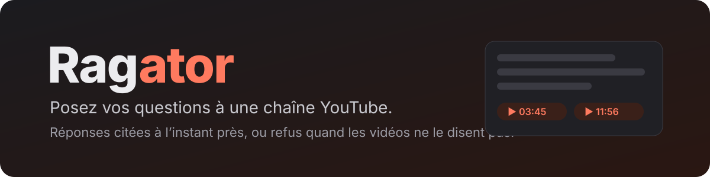
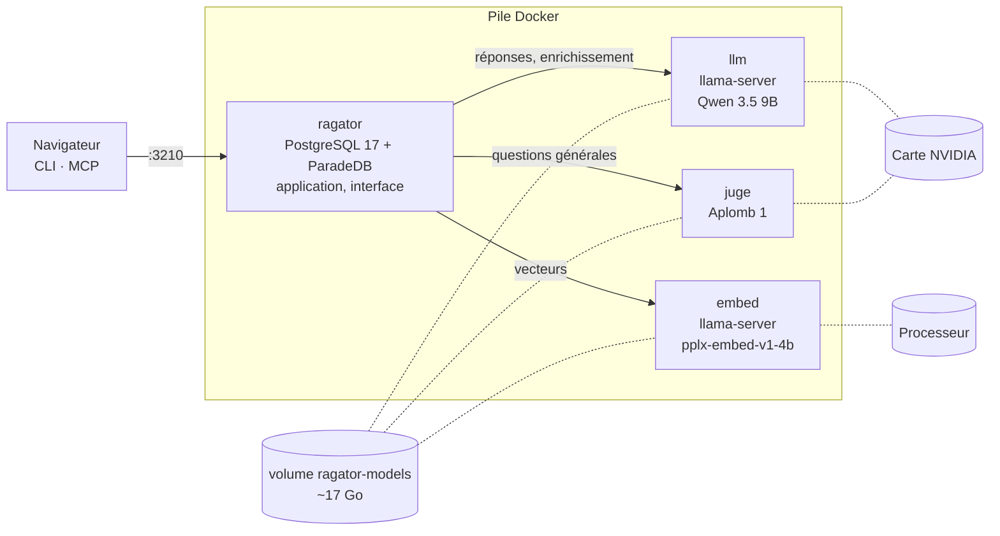
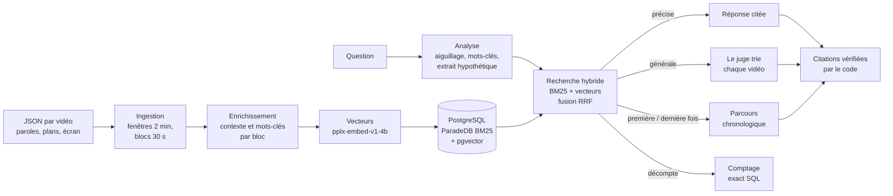

<p align="center">
  
</p>

<p align="center">
  <a href="LICENSE"></a>
  
  
  
  
  
  
</p>

<p align="center">
  <b>Posez vos questions à une chaîne YouTube, et obtenez la réponse avec l'instant exact de la vidéo qui la prouve.</b>
</p>

Ragator indexe les transcriptions et les descriptions visuelles des vidéos d'une ou plusieurs chaînes YouTube, puis répond aux questions en langage naturel en **citant chaque affirmation au timecode près**. Quand les vidéos ne contiennent pas la réponse, il le dit au lieu d'inventer.

- 🏠 **100 % local** : Qwen 3.5 9B, le juge Aplomb et pplx-embed tournent sur votre carte graphique. Aucune clé, rien ne sort de la machine.
- ☁️ **Ou OpenRouter**, sans carte graphique : un clic dans les Réglages pour changer de mode, sans réindexer.
- 🎯 **Réponses citées** : chaque phrase renvoie au moment exact de la vidéo, vérifié par le code.
- 🔎 **Recherche hybride** : mots exacts (BM25 : marques, noms propres, fautes de frappe) et sens (vecteurs).
- 🧭 **Plusieurs types de questions** : précises, générales, décomptes, « la première fois que… ».
- 💬 **Relances** : « et dans cette vidéo ? », « et la dernière fois ? ».
- 📚 **Plusieurs chaînes** dans une même base, avec un filtre par chaîne.
- 🖥️ **Interface web**, ligne de commande et **serveur MCP** pour Claude, Cursor et les autres clients IA.

```text
> Quelle colle utilisent-ils pour fixer le plan de travail ?
Ils collent le plan de travail à la colle polyuréthane, puis le maintiennent avec des serre-joints
pendant le séchage. [▶ 12:41]
Sources :
- Rénover une cuisine pour 300 € — 12:41
  https://www.youtube.com/watch?v=…&t=761s
```

## Sommaire

- [Deux modes : local ou OpenRouter](#deux-modes--local-ou-openrouter)
- [La stack locale](#la-stack-locale)
- [Ce qu'il sait faire](#ce-quil-sait-faire)
- [Configuration requise](#configuration-requise)
- [Installation](#installation)
- [Premiers pas](#premiers-pas)
- [Préparer les vidéos](#préparer-les-vidéos)
- [Utilisation](#utilisation)
- [Données, sauvegarde et mise à jour](#données-sauvegarde-et-mise-à-jour)
- [Sécurité](#sécurité)
- [Fonctionnement](#fonctionnement)
- [Développement](#développement)
- [Licence](#licence)

## Deux modes : local ou OpenRouter

Une seule instance de Ragator, une seule base. Le mode se choisit dans l'onglet **Réglages** et se change à tout moment : les deux modes utilisent le même encodeur de vecteurs, donc le même index.

| | 🏠 Local | ☁️ OpenRouter |
|---|---|---|
| Réponses et enrichissement | Qwen 3.5 9B (llama.cpp, carte graphique) | `openai/gpt-6-luna` (modifiable) |
| Juge des questions générales | Aplomb 1 en 4 bits (carte graphique) | `typesafe/jev-1.13` |
| Vecteurs | pplx-embed-v1-4b en GGUF Q8 (processeur) | `perplexity/pplx-embed-v1-4b` |
| Matériel | carte NVIDIA, 16 Go de mémoire vidéo | aucun |
| Clé | aucune (un jeton Hugging Face, une fois, pour télécharger Aplomb) | clé OpenRouter payante |
| Confidentialité | rien ne sort de la machine une fois les modèles téléchargés | questions et extraits envoyés à OpenRouter |
| Coût | l'électricité | ~0,001 $ par question précise, ~0,02 $ par question générale, < 1 $ pour indexer 400 vidéos |
| Vitesse | plus lent, surtout l'indexation (vecteurs sur le processeur) | plus rapide (~5 s par question précise) |

Sans mode choisi, Ragator reste utilisable : recherche par mots et réponses faites des extraits trouvés, avec leurs liens horodatés.

## La stack locale

Le mode local ajoute trois serveurs de modèles à côté de Ragator, dans la même pile Docker (profil `local` de [compose.yml](compose.yml)). Ragator les joint par le réseau interne de la pile : aucun port supplémentaire n'est ouvert sur la machine.



| Service | Modèle | Rôle | Matériel | Taille |
|---|---|---|---|---|
| `ragator` | — | base PostgreSQL 17 + ParadeDB (BM25, pgvector), application, interface web, CLI, MCP | processeur, ~1 Go de RAM | image ~1 Go |
| `llm` | [Qwen 3.5 9B](https://huggingface.co/unsloth/Qwen3.5-9B-MTP-GGUF) `UD-Q4_K_XL`, tête MTP intégrée | analyse des questions, rédaction des réponses, enrichissement des passages à l'indexation | carte graphique, ~11 Go de mémoire vidéo | modèle ~6 Go |
| `juge` | [Aplomb 1](https://huggingface.co/empiriolabsai/aplomb-1), 4 bits (NF4), sans vision ni audio | probabilité que chaque vidéo candidate réponde à une question générale | carte graphique, ~5,3 Go de mémoire vidéo | modèle ~10 Go, image PyTorch CUDA |
| `embed` | [pplx-embed-v1-4b](https://huggingface.co/seamon67/PPLX-Embed-v1-4B-GGUF) `Q8_0` | vecteurs des passages et des questions | processeur, ~1,5 Go de RAM | modèle ~4 Go |

**Comment c'est réglé**

- **Qwen 3.5 9B** sert 8 requêtes à la fois sur un contexte de 81 920 tokens partagé (cache en 8 bits), à température 0 : réponses reproductibles. Le décodage spéculatif par sa tête MTP accélère la génération sans changer la sortie. Sa « réflexion » est coupée.
- **Petit modèle, garde-fous en plus** : en mode local, chaque affirmation commence par sa preuve recopiée mot pour mot, et le rédacteur revérifie chaque vidéo retenue par le juge (précision des questions générales 46 → 64 %).
- **Aplomb** est un modèle de *décision* : pour chaque vidéo, il donne la probabilité qu'elle réponde à la question prise au mot (« quand *utilisent*-ils » exige qu'ils l'utilisent). En 4 bits, il note environ 0,1 plus haut que JEV : son seuil est 0,4 au lieu de 0,3.
- **pplx-embed** tourne sur le processeur, par petits lots : il laisse la carte au LLM et au juge. C'est le même encodeur que celui d'OpenRouter (vecteurs identiques à un cosinus de 0,98-0,99 près), d'où l'index commun aux deux modes.

**Premier démarrage.** Chaque serveur télécharge son modèle dans le volume `ragator-models` (~17 Go en tout), puis le charge : comptez plusieurs minutes. L'onglet Réglages affiche l'état de chacun (prêt, en préparation, jeton attendu, injoignable). Ensuite, plus aucun accès extérieur.

**Aplomb est sous licence.** Acceptez-la sur [huggingface.co/empiriolabsai/aplomb-1](https://huggingface.co/empiriolabsai/aplomb-1), créez un jeton de lecture ([huggingface.co/settings/tokens](https://huggingface.co/settings/tokens)) et collez-le dans **Réglages** : Ragator le transmet au juge, qui télécharge le modèle. Le jeton ne sert qu'à ce téléchargement ; le modèle n'est jamais redistribué.

<details>
<summary>Modèles sur une autre machine (PC à carte graphique qui sert un NAS)</summary>

Ragator peut tourner sur un NAS sans carte graphique et utiliser les modèles d'un PC qui en a une. Sur le PC, lancez seulement les trois serveurs, en publiant leurs ports (ajoutez `ports: ['8080:8080']` à `llm`, `['8081:8080']` à `embed` et `['8000:8000']` à `juge` dans `compose.yml`) :

```bash
docker compose --profile local up -d llm embed juge
```

Puis, dans **Réglages → Serveurs sur une autre machine**, indiquez `http://<ip-du-pc>:8080/v1`, `http://<ip-du-pc>:8081/v1` et `http://<ip-du-pc>:8000`. Ces ports n'ont pas de mot de passe : ne les ouvrez que sur votre réseau local.

</details>

<details>
<summary>Ajuster la charge de la carte graphique</summary>

Les places (`-np 8`) et le contexte (`-c 81920`) de `llm` sont dans `compose.yml`. Ragator découpe ses requêtes en conséquence : si vous les changez, donnez les mêmes valeurs au service `ragator` (`environment: { LOCAL_LLM_PARALLEL: '4', LOCAL_LLM_CONTEXT: '65536' }`). Moins de places ou moins de contexte réduisent la mémoire vidéo occupée, au prix de questions générales plus lentes.

</details>

<details>
<summary>Unraid et autres NAS</summary>

Installez le pilote NVIDIA (plugin « Nvidia Driver », version 580 ou plus). Si la réservation de carte de `compose.yml` (`deploy.resources`) n'est pas prise en charge, remplacez-la dans `x-gpu` par :

```yaml
x-gpu: &gpu
  runtime: nvidia
  environment:
    NVIDIA_VISIBLE_DEVICES: all
    NVIDIA_DRIVER_CAPABILITIES: compute,utility
```

Placez les volumes sur un vrai disque (pas sur un dossier en mémoire vive) : voir [Installation](#installation).

</details>

## Ce qu'il sait faire

Chaque famille de questions suit son propre chemin :

| Question | Exemple | Réponse |
|---|---|---|
| **Précise** | « Quel firmware pour transformer un ESP32 en répéteur Wi-Fi ? » | quelques affirmations citées |
| **Générale** | « Quand utilisent-ils une imprimante 3D ? » | une ligne par vidéo pertinente, les plus sûres d'abord |
| **Décompte** | « Toutes les vidéos où on parle de Raspberry Pi » | liste exacte calculée par la base, sans IA, ~2 s |
| **Première / dernière mention** | « La première mention du PLA » | la plus ancienne (ou récente) vidéo avec son extrait, puis toutes par date |
| **Première / dernière fois** | « La première fois qu'ils utilisent une scie circulaire » | les vidéos examinées dans l'ordre du temps jusqu'à celle qui montre l'action |

## Configuration requise

| Élément | Mode local | Mode OpenRouter |
|---|---|---|
| Docker | Docker Desktop (Windows avec WSL 2, macOS exclu) ou Docker Engine (Linux, NAS) avec Compose | Docker Desktop ou Docker Engine avec Compose |
| Carte graphique | NVIDIA, 16 Go de mémoire vidéo ou plus, pilote 580 ou plus (CUDA 13) ; sous Linux, [NVIDIA Container Toolkit](https://docs.nvidia.com/datacenter/cloud-native/container-toolkit/latest/install-guide.html) | aucune |
| Mémoire | ~4 Go de RAM | ~1 Go de RAM pour quelques centaines de vidéos |
| Disque | ~17 Go de modèles, plus les images Docker | quelques centaines de Mo |
| Compte | [Hugging Face](https://huggingface.co), licence d'Aplomb acceptée | [OpenRouter](https://openrouter.ai/keys), avec du crédit |
| Vidéos | un fichier JSON par vidéo, produit par [yt2md](https://github.com/lfpoulain/yt2md) (voir [Préparer les vidéos](#préparer-les-vidéos)) | idem |

## Installation

```bash
git clone https://github.com/lfpoulain/ragator.git
cd ragator
```

**Mode local** (Ragator et les trois serveurs de modèles) :

```bash
docker compose --profile local up -d --build
```

**Mode OpenRouter seul** (Ragator, sans serveurs de modèles ni carte graphique) :

```bash
docker compose up -d --build
```

Ouvrez <http://localhost:3210> (ou `http://<adresse-du-serveur>:3210`). Aucune variable d'environnement, aucun fichier de configuration : tout se règle dans l'interface.

L'image `ragator` contient tout le reste : PostgreSQL 17 avec ParadeDB (recherche BM25 et vecteurs), l'application et l'interface web. Les données vivent dans le volume Docker `ragator-data`, les modèles dans `ragator-models`.

<details>
<summary>Sans Docker Compose (<code>docker run</code>, Portainer…), mode OpenRouter</summary>

```bash
docker build -t ragator https://github.com/lfpoulain/ragator.git
docker run -d --name ragator --restart unless-stopped --shm-size 1g \
  -p 3210:3210 -v /chemin/vers/ragator:/data ragator
```

`/data` doit être sur un vrai disque : un dossier en mémoire vive serait perdu au redémarrage, et le conteneur refuse d'y créer la base. Pour le mode local, préférez Compose, ou pointez Ragator vers des serveurs de modèles existants (voir [Modèles sur une autre machine](#la-stack-locale)).

</details>

## Premiers pas

1. **Réglages** → choisissez le mode.
   - **Local** : collez votre jeton Hugging Face, puis attendez que les trois serveurs soient « prêts ».
   - **OpenRouter** : collez votre clé. Elle est vérifiée, puis enregistrée dans la base de Ragator.
2. **Réglages** → définissez un mot de passe si Ragator est joignable depuis le réseau.
3. **Administration** → déposez vos fichiers `video--<id>.json`. Ils sont vérifiés, puis indexés automatiquement.
4. **Rechercher** → posez votre question.

L'onglet Administration suit l'indexation en direct : vidéos ajoutées, passages enrichis, vecteurs calculés, et l'état de chaque vidéo. Une indexation interrompue (serveur de modèles pas encore prêt, crédit épuisé, redémarrage) reprend là où elle s'était arrêtée.

## Préparer les vidéos

Ragator n'analyse pas les vidéos lui-même : il lit un fichier JSON par vidéo, avec la transcription horodatée, la description des plans et le texte affiché à l'écran.

[**yt2md**](https://github.com/lfpoulain/yt2md) produit exactement ces fichiers, lui aussi entièrement en local : collez le lien d'une chaîne, transcrivez, puis déposez le contenu de son dossier `outputs/` (les `video--<id>.json`) dans l'onglet Administration. Avec le mode local de Ragator, toute la chaîne, de la vidéo YouTube à la réponse, tourne chez vous.

Pour un gros volume, montez directement le dossier dans le conteneur (dans `compose.yml`) :

```yaml
    volumes:
      - ragator-data:/data
      - /chemin/vers/yt2md/outputs:/data/corpus
```

Le format est décrit par [schemas/corpus.schema.json](schemas/corpus.schema.json) ; deux exemples complets sont dans [tests/fixtures/](tests/fixtures/). Chaque vidéo est rangée dans la collection de sa chaîne (« Ma Chaîne, sous-titre » → `ma-chaine`).

## Utilisation

### Interface web

| Onglet | Rôle |
|---|---|
| **Rechercher** | questions, réponses détaillées, courtes ou faites d'extraits ; filtre par chaîne ; vidéos proches de chaque vidéo citée |
| **Administration** | dépôt de vidéos, mise à jour de l'index, état du corpus et de chaque vidéo, bilan par chaîne |
| **Réglages** | mode local ou OpenRouter, état des serveurs locaux, jeton Hugging Face, clé et modèle OpenRouter, mot de passe |

### Ligne de commande

```bash
docker exec -it ragator ragator ask "Quand utilisent-ils une imprimante 3D ?"
docker exec -it ragator ragator chat             # conversation avec relances
docker exec -it ragator ragator stats            # état du corpus et de l'index
docker exec -it ragator ragator journal --echecs # questions posées sans réponse
```

| Commande | Rôle |
|---|---|
| `ask "question"` | réponse citée ; `--court`, `--extractif`, `--sources N`, `--collection clé`, `--json` |
| `chat` | conversation avec relances ; `/reset` efface l'historique |
| `update [--surveiller N]` | indexe les vidéos nouvelles ou modifiées (toutes les N minutes avec `--surveiller`) |
| `collections` | chaînes du corpus, avec leur clé et leur nombre de vidéos |
| `journal [--echecs --jours N]` | questions posées : refus, rien de cité, erreurs |
| `stats` | état du corpus, des vecteurs et des index |

La ligne de commande et le serveur MCP utilisent le mode et les réglages choisis dans l'interface.

### Serveur MCP

Ragator expose six outils de consultation à un client IA (Claude Desktop, Claude Code, Cursor…) : recherche, réponse citée, liste de vidéos, lecture d'un passage… Dans la configuration MCP du client :

```json
{
  "mcpServers": {
    "ragator": { "command": "docker", "args": ["exec", "-i", "ragator", "ragator", "mcp"] }
  }
}
```

## Données, sauvegarde et mise à jour

Tout est dans le volume `/data` : la base (`postgres/` : vidéos indexées, vecteurs, réglages, journal des questions) et les fichiers déposés (`corpus/`). Les modèles du mode local sont dans le volume `ragator-models` : inutile de les sauvegarder, ils se retéléchargent.

```bash
# Sauvegarde à chaud
docker exec ragator pg_dump -U ragator -Fc ragator > ragator-$(date +%F).dump

# Restauration
docker exec -i ragator pg_restore -U ragator -d ragator --clean --if-exists --no-owner < ragator.dump
docker restart ragator

# Mise à jour de Ragator : les données sont conservées, les migrations s'appliquent seules
git pull && docker compose --profile local up -d --build    # ou sans --profile local
```

## Sécurité

- **Mot de passe** : sans mot de passe, toute personne qui atteint le port peut poser des questions, ajouter des vidéos et changer les réglages. Définissez-en un dès que Ragator est joignable depuis le réseau. Pour le garder sur votre seule machine, publiez le port sur `127.0.0.1:3210:3210` dans `compose.yml`.
- **Nom de domaine** : l'interface s'ouvre toujours par `localhost` ou une adresse IP ; par un nom (`ragator.maison.lan`, reverse proxy), seulement une fois un mot de passe défini. C'est une protection contre le rebinding DNS.
- **Accès depuis Internet** : ne redirigez jamais le port sur votre box. Passez par un VPN, ou par un reverse proxy en HTTPS ; une question générale peut durer une minute, allongez son délai (`proxy_read_timeout 300s;` pour nginx).
- **Serveurs de modèles** : dans la pile, ils ne sont joignables que par Ragator. Si vous publiez leurs ports (modèles sur une autre machine), limitez-les à votre réseau local.
- La clé OpenRouter et le jeton Hugging Face ne sont jamais renvoyés à la page : seuls leurs quatre derniers caractères sont affichés.

## Fonctionnement



- **La recherche** combine un index lexical BM25 (mots exacts, marques, noms propres, correction orthographique) et une recherche par vecteurs (sens), sur les phrases et sur des blocs de 30 s enrichis. Les listes sont fusionnées (RRF).
- **Le modèle ne voit que des extraits numérotés** et doit citer leurs identifiants dans une sortie JSON imposée ; le code vérifie chaque citation et retire toute affirmation sans preuve valable. Pas de preuve : refus.
- **Les questions générales** passent par un modèle de *décision* (Aplomb en local, [JEV](https://openrouter.ai/typesafe/jev-1.13) par OpenRouter) qui donne pour chaque vidéo candidate la probabilité qu'elle réponde à la question, prise au mot.

| Rôle | Mode local | Mode OpenRouter |
|---|---|---|
| Analyse de la question, rédaction, enrichissement | Qwen 3.5 9B | `openai/gpt-6-luna` (modifiable dans Réglages) |
| Tri des vidéos des questions générales | Aplomb 1 (seuil 0,4) | `typesafe/jev-1.13` (seuil 0,3) |
| Vecteurs | pplx-embed-v1-4b (GGUF Q8) | `perplexity/pplx-embed-v1-4b` |

Pour aller plus loin : [les chemins de recherche](docs/mecaniques-de-recherche.md) et [le fonctionnement détaillé](docs/fonctionnement.md), de l'indexation à la réponse.

## Développement

Prérequis : Node.js 24.2+ et Docker (pour la base).

```bash
npm ci
cp .env.example .env     # mode, clé ou adresses des serveurs locaux ; les Réglages de l'interface priment
npm run db:up            # PostgreSQL + ParadeDB sur 127.0.0.1:15432
npm run db:migrate
npm run web              # http://127.0.0.1:3210
npm run check            # types + tests (les tests d'intégration demandent la base)
```

```text
src/core/       pipeline : ingestion, enrichissement, vecteurs, recherche, aiguillage, réponse
src/db/         pool, migrations, accès aux tables
src/norm/       normalisation du texte, marques, locuteurs, mots vides
src/windows/    fenêtres de 2 min, blocs de 30 s
src/providers/  clients des modèles : LLM, vecteurs, juges (JEV, Aplomb)
src/prompts/    prompts et schémas de sortie, versionnés
src/cli/  src/web/  src/mcp/   ligne de commande, interface web, serveur MCP
migrations/     schéma SQL
docker/         démarrage du conteneur, serveur du juge local (docker/juge)
tests/          tests unitaires et d'intégration
```

La liste des marques reconnues (`src/norm/brands.ts`) est orientée bricolage et électronique : à étoffer pour un autre domaine.

## Licence

[MIT](LICENSE). Les modèles gardent leurs propres licences (Qwen, pplx-embed, Aplomb sous licence EmpirioLabs) : ils sont téléchargés depuis Hugging Face, jamais redistribués avec Ragator.
