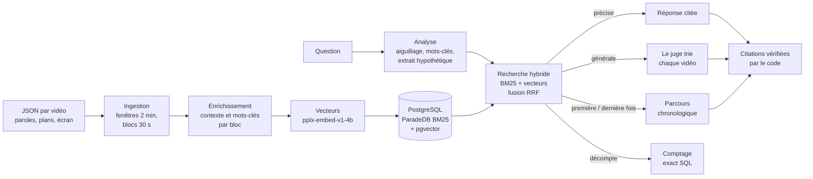

<p align="center">
  
</p>

<p align="center">
  <a href="LICENSE"></a>
  
  
  
  
  
</p>

<p align="center">
  <b>Posez vos questions à une chaîne YouTube, et obtenez la réponse avec l'instant exact de la vidéo qui la prouve.</b>
</p>

Ragator indexe les transcriptions et les descriptions visuelles des vidéos d'une ou plusieurs chaînes YouTube, puis répond aux questions en langage naturel en **citant chaque affirmation au timecode près**. Quand les vidéos ne contiennent pas la réponse, il le dit au lieu d'inventer.

- 🎯 **Réponses citées** : chaque phrase renvoie au moment exact de la vidéo, vérifié par le code
- 🔎 **Recherche hybride** : mots exacts (BM25, marques, noms propres, fautes de frappe) et sens (vecteurs)
- 🧭 **Plusieurs types de questions** : précises, générales, décomptes, « la première fois que… »
- 💬 **Relances** : « et dans cette vidéo ? », « et la dernière fois ? »
- 📚 **Plusieurs chaînes** dans une même base, avec un filtre par chaîne
- 🖥️ **Interface web**, ligne de commande et **serveur MCP** pour Claude, Cursor et les autres clients IA
- 🐳 **Une seule image Docker**, sur votre PC ou sur un serveur : la clé se règle dans l'interface

```text
> Quelle colle utilisent-ils pour fixer le plan de travail ?
Ils collent le plan de travail à la colle polyuréthane, puis le maintiennent avec des serre-joints
pendant le séchage. [▶ 12:41]
Sources :
- Rénover une cuisine pour 300 € — 12:41
  https://www.youtube.com/watch?v=…&t=761s
```

## Sommaire

- [Ce qu'il sait faire](#ce-quil-sait-faire)
- [Configuration requise](#configuration-requise)
- [Installation](#installation)
- [Premiers pas](#premiers-pas)
- [Préparer les vidéos](#préparer-les-vidéos)
- [Utilisation](#utilisation)
- [Données, sauvegarde et mise à jour](#données-sauvegarde-et-mise-à-jour)
- [Sécurité](#sécurité)
- [Fonctionnement](#fonctionnement)
- [Développement](#développement)
- [Licence](#licence)

## Ce qu'il sait faire

Chaque famille de questions suit son propre chemin :

| Question | Exemple | Réponse |
|---|---|---|
| **Précise** | « Quel firmware pour transformer un ESP32 en répéteur Wi-Fi ? » | quelques affirmations citées, ~5 s |
| **Générale** | « Quand utilisent-ils une imprimante 3D ? » | une ligne par vidéo pertinente, les plus sûres d'abord, ~12 s |
| **Décompte** | « Toutes les vidéos où on parle de Raspberry Pi » | liste exacte calculée par la base, sans IA, ~2 s |
| **Première / dernière mention** | « La première mention du PLA » | la plus ancienne (ou récente) vidéo avec son extrait, puis toutes par date |
| **Première / dernière fois** | « La première fois qu'ils utilisent une scie circulaire » | les vidéos examinées dans l'ordre du temps jusqu'à celle qui montre l'action |

Sans clé OpenRouter, Ragator reste utilisable : recherche par mots et réponses faites des extraits trouvés, avec leurs liens horodatés.

## Configuration requise

| Élément | Requis |
|---|---|
| Docker | Docker Desktop (Windows, macOS) ou Docker Engine (Linux, NAS) avec Compose |
| Mémoire | ~1 Go de RAM pour quelques centaines de vidéos |
| Clé API | une clé [OpenRouter](https://openrouter.ai/keys), saisie dans l'interface |
| Vidéos | un fichier JSON par vidéo, produit par [yt2md](https://github.com/lfpoulain/yt2md) (voir [Préparer les vidéos](#préparer-les-vidéos)) |

Aucune carte graphique n'est nécessaire : les modèles sont appelés par OpenRouter.

| | Coût indicatif |
|---|---|
| Indexer 400 vidéos | moins de 1 $ (une seule fois) |
| Question précise | ~0,001 $ |
| Question générale | ~0,02 $ |

## Installation

La même commande fonctionne sur un PC comme sur un serveur ou un NAS :

```bash
git clone https://github.com/lfpoulain/ragator.git
cd ragator
docker compose up -d --build
```

Ouvrez <http://localhost:3210> (ou `http://<adresse-du-serveur>:3210`). C'est tout : aucune variable d'environnement, aucun fichier de configuration.

L'image contient tout : PostgreSQL 17 avec ParadeDB (recherche BM25 et vecteurs), l'application et l'interface web. Les données vivent dans le volume Docker `ragator-data`.

<details>
<summary>Sans Docker Compose (<code>docker run</code>, NAS, Portainer…)</summary>

```bash
docker build -t ragator https://github.com/lfpoulain/ragator.git
docker run -d --name ragator --restart unless-stopped --shm-size 1g \
  -p 3210:3210 -v /chemin/vers/ragator:/data ragator
```

`/data` doit être sur un vrai disque : un dossier en mémoire vive serait perdu au redémarrage, et le conteneur refuse d'y créer la base.

</details>

## Premiers pas

1. **Réglages** → collez votre clé OpenRouter. Elle est vérifiée, puis enregistrée dans la base de Ragator.
2. **Réglages** → définissez un mot de passe si Ragator est joignable depuis le réseau.
3. **Administration** → déposez vos fichiers `video--<id>.json`. Ils sont vérifiés, puis indexés automatiquement (~15 s par vidéo).
4. **Rechercher** → posez votre question.

L'onglet Administration suit l'indexation en direct : vidéos ajoutées, passages enrichis, vecteurs calculés, et l'état de chaque vidéo. Une indexation interrompue (crédit OpenRouter épuisé, redémarrage) reprend là où elle s'était arrêtée.

## Préparer les vidéos

Ragator n'analyse pas les vidéos lui-même : il lit un fichier JSON par vidéo, avec la transcription horodatée, la description des plans et le texte affiché à l'écran.

[**yt2md**](https://github.com/lfpoulain/yt2md) produit exactement ces fichiers, entièrement en local : collez le lien d'une chaîne, transcrivez, puis déposez le contenu de son dossier `outputs/` (les `video--<id>.json`) dans l'onglet Administration.

Pour un gros volume, montez directement le dossier dans le conteneur (dans `compose.yml`) :

```yaml
    volumes:
      - ragator-data:/data
      - /chemin/vers/yt2md/outputs:/data/corpus
```

Le format est décrit par [schemas/corpus.schema.json](schemas/corpus.schema.json) ; deux exemples complets sont dans [tests/fixtures/](tests/fixtures/). Chaque vidéo est rangée dans la collection de sa chaîne (« Ma Chaîne, sous-titre » → `ma-chaine`).

## Utilisation

### Interface web

| Onglet | Rôle |
|---|---|
| **Rechercher** | questions, réponses détaillées, courtes ou faites d'extraits ; filtre par chaîne ; vidéos proches de chaque vidéo citée |
| **Administration** | dépôt de vidéos, mise à jour de l'index, état du corpus et de chaque vidéo, bilan par chaîne |
| **Réglages** | clé OpenRouter, modèle des réponses, mot de passe |

### Ligne de commande

```bash
docker exec -it ragator ragator ask "Quand utilisent-ils une imprimante 3D ?"
docker exec -it ragator ragator chat             # conversation avec relances
docker exec -it ragator ragator stats            # état du corpus et de l'index
docker exec -it ragator ragator journal --echecs # questions posées sans réponse
```

| Commande | Rôle |
|---|---|
| `ask "question"` | réponse citée ; `--court`, `--extractif`, `--sources N`, `--collection clé`, `--json` |
| `chat` | conversation avec relances ; `/reset` efface l'historique |
| `update [--surveiller N]` | indexe les vidéos nouvelles ou modifiées (toutes les N minutes avec `--surveiller`) |
| `collections` | chaînes du corpus, avec leur clé et leur nombre de vidéos |
| `journal [--echecs --jours N]` | questions posées : refus, rien de cité, erreurs |
| `stats` | état du corpus, des vecteurs et des index |

### Serveur MCP

Ragator expose six outils de consultation à un client IA (Claude Desktop, Claude Code, Cursor…) : recherche, réponse citée, liste de vidéos, lecture d'un passage… Dans la configuration MCP du client :

```json
{
  "mcpServers": {
    "ragator": { "command": "docker", "args": ["exec", "-i", "ragator", "ragator", "mcp"] }
  }
}
```

## Données, sauvegarde et mise à jour

Tout est dans le volume `/data` : la base (`postgres/`, vidéos indexées, vecteurs, réglages, journal des questions) et les fichiers déposés (`corpus/`).

```bash
# Sauvegarde à chaud
docker exec ragator pg_dump -U ragator -Fc ragator > ragator-$(date +%F).dump

# Restauration
docker exec -i ragator pg_restore -U ragator -d ragator --clean --if-exists --no-owner < ragator.dump
docker restart ragator

# Mise à jour de Ragator : les données sont conservées, les migrations s'appliquent seules
git pull && docker compose up -d --build
```

## Sécurité

- **Mot de passe** : sans mot de passe, toute personne qui atteint le port peut poser des questions, ajouter des vidéos et changer la clé. Définissez-en un dès que Ragator est joignable depuis le réseau. Pour le garder sur votre seule machine, publiez le port sur `127.0.0.1:3210:3210` dans `compose.yml`.
- **Nom de domaine** : l'interface s'ouvre toujours par `localhost` ou une adresse IP ; par un nom (`ragator.maison.lan`, reverse proxy), seulement une fois un mot de passe défini. C'est une protection contre le rebinding DNS.
- **Accès depuis Internet** : ne redirigez jamais le port sur votre box. Passez par un VPN, ou par un reverse proxy en HTTPS ; une question générale peut durer une minute, allongez son délai (`proxy_read_timeout 300s;` pour nginx).
- La clé OpenRouter n'est jamais renvoyée à la page : seuls ses quatre derniers caractères sont affichés.

## Fonctionnement



- **La recherche** combine un index lexical BM25 (mots exacts, marques, noms propres, correction orthographique) et une recherche par vecteurs (sens), sur les phrases et sur des blocs de 30 s enrichis. Les listes sont fusionnées (RRF).
- **Le modèle ne voit que des extraits numérotés** et doit citer leurs identifiants dans une sortie JSON imposée ; le code vérifie chaque citation et retire toute affirmation sans preuve valable. Pas de preuve : refus.
- **Les questions générales** passent par [JEV](https://openrouter.ai/typesafe/jev-1.13), un modèle de *décision* qui donne pour chaque vidéo candidate la probabilité qu'elle réponde à la question, prise au mot (« quand *utilisent*-ils » exige qu'ils l'utilisent).

| Rôle | Modèle (par OpenRouter) |
|---|---|
| Analyse de la question, rédaction, enrichissement | `openai/gpt-6-luna` (modifiable dans Réglages) |
| Tri des vidéos des questions générales | `typesafe/jev-1.13` |
| Vecteurs | `perplexity/pplx-embed-v1-4b` |

Pour aller plus loin : [les chemins de recherche](docs/mecaniques-de-recherche.md) et [le fonctionnement détaillé](docs/fonctionnement.md), de l'indexation à la réponse.

## Développement

Prérequis : Node.js 24.2+ et Docker (pour la base).

```bash
npm ci
cp .env.example .env     # clé OpenRouter facultative ici : celle des Réglages prime
npm run db:up            # PostgreSQL + ParadeDB sur 127.0.0.1:15432
npm run db:migrate
npm run web              # http://127.0.0.1:3210
npm run check            # types + tests (les tests d'intégration demandent la base)
```

```text
src/core/       pipeline : ingestion, enrichissement, vecteurs, recherche, aiguillage, réponse
src/db/         pool, migrations, accès aux tables
src/norm/       normalisation du texte, marques, locuteurs, mots vides
src/windows/    fenêtres de 2 min, blocs de 30 s
src/providers/  clients OpenRouter : LLM, vecteurs, juge
src/prompts/    prompts et schémas de sortie, versionnés
src/cli/  src/web/  src/mcp/   ligne de commande, interface web, serveur MCP
migrations/     schéma SQL
docker/         démarrage du conteneur
tests/          tests unitaires et d'intégration
```

La liste des marques reconnues (`src/norm/brands.ts`) est orientée bricolage et électronique : à étoffer pour un autre domaine.

## Licence

[MIT](LICENSE)
