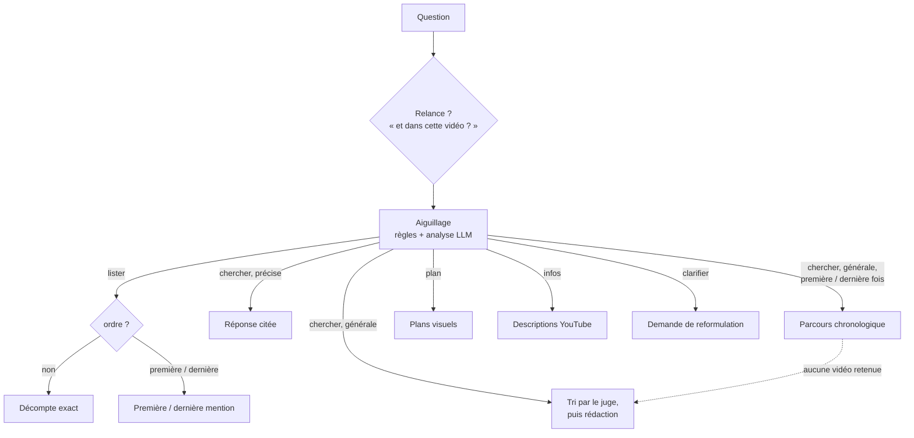

# Mécaniques de recherche

Ragator ne répond pas à toutes les questions de la même façon. Selon ce qui est demandé, il prend un
**chemin** différent : compter, citer un passage, parcourir des dizaines de vidéos, remonter le temps.
Ce document décrit chaque chemin :
- quand il s'applique ;
- ses étapes ;
- les modèles qu'il appelle ;
- ce que le code garantit ;
- ce qu'il coûte en temps.

Le détail des composants (indexation, recherche hybride, base) est dans
[fonctionnement.md](fonctionnement.md).

Les modèles tournent sur la machine (mode local) ou passent par OpenRouter, au choix dans l'onglet
Réglages. Les chemins sont les mêmes ; les exemples ci-dessous nomment les modèles OpenRouter.

| Rôle | Mode local | Mode OpenRouter |
|---|---|---|
| Analyse de la question et rédaction | Qwen 3.5 9B | gpt-6-luna |
| Juge des vidéos (questions générales) | Aplomb 1 (seuil 0,4) | `typesafe/jev-1.13` (seuil 0,3) |
| Vecteurs | pplx-embed-v1-4b (GGUF Q8) | `perplexity/pplx-embed-v1-4b` |

Tous les chemins acceptent une **collection** (une chaîne YouTube, voir
[fonctionnement.md](fonctionnement.md#31-collection-relance-et-aiguillage)) : chaque requête se
limite alors aux vidéos de cette chaîne, et la ligne « Corpus » en tête des prompts la nomme.

## Vue d'ensemble

| Chemin | Exemple | Modèles appelés | Temps typique |
|---|---|---|---|
| [Réponse citée](#2-réponse-citée) | « Quel firmware pour transformer un ESP32 en répéteur Wi-Fi ? » | LLM | ~5 s |
| [Tri par le juge](#3-tri-par-le-juge-puis-rédaction) | « Quand utilisent-ils de la résine époxy ? » | juge + LLM | ~12 s |
| [Parcours chronologique](#4-parcours-chronologique) | « La première fois qu'ils utilisent une scie circulaire Einhell » | juge + LLM | ~4 s |
| [Décompte exact](#5-décompte-exact) | « Toutes les vidéos où on parle de NordVPN » | aucun | ~2 s |
| [Première / dernière mention](#6-première--dernière-mention) | « La première mention du PLA » | aucun | ~2 s |
| [Plans visuels](#7-plans-visuels) | « À quel moment voit-on un tournevis ? » | LLM | — |
| [Descriptions YouTube](#8-descriptions-youtube) | « Le lien du firmware de la caméra » | LLM | — |
| [Crédits](#8-bis-crédits) | « Quand Alice Martin a monté la vidéo ? » | aucun | — |
| [Reformulation](#9-reformulation) | « Montre-moi un truc cool » | aucun | immédiat |

Le temps de l'aiguillage est compris : l'analyse par LLM prend ~1 s.

## 1. L'aiguillage, commun à tous les chemins

`repondre()` (`src/core/answer.ts`) est la seule fonction de réponse : l'interface web, la ligne de
commande et le serveur MCP l'appellent tous.

1. **Relance** (`src/core/followup.ts`, `src/core/scene-memory.ts`). Le chat garde pendant cinq
   échanges l’identifiant de vidéo, l’identifiant de source et la seconde de début de chaque scène
   citée. Le serveur retrouve la source à ces coordonnées dans la collection active. Une demande
   de minutage avec un seul repère se résout directement. Un choix comme « la deuxième » reprend
   la question en attente. Pour répondre sur le contenu, le modèle lit les extraits et fournit une
   citation vérifiée. Une précision trouvée dans le voisinage a sa propre citation et laisse le
   repère initial disponible au tour suivant. Les relances portant sur toute une vidéo ou sur
   un décompte reprennent la recherche correspondante. Si le détail manque au passage,
   une proposition permet d’élargir aux autres épisodes. En cas d’accord au tour suivant,
   Ragator retrouve les vidéos dont le titre partage des mots distinctifs avec le projet,
   puis le modèle sélectionne les suites parmi ces seuls titres. La recherche reprend la
   question en attente dans ces vidéos. Un refus conserve les repères précédents.
2. **Règles** (`src/core/classify.ts`), déterministes et testables sans LLM. Elles reconnaissent :
   - les décomptes (« toutes les vidéos où… ») ;
   - les formules « première / dernière » ;
   - les demandes de description (« le lien de… ») ;
   - les plans (« à quel moment voit-on… ») ;
   - la **portée** : paroles (« on parle de »), image (« on voit »), texte à l'écran, ou tout.
3. **Analyse par LLM** (`src/core/analyze.ts`, à température 0). Elle propose :

   | Champ | Rôle | Validé par le code |
   |---|---|---|
   | route | le chemin | une route étroite (plan, infos, clarifier) seulement si les règles l'ont aussi choisie |
   | générale | plusieurs vidéos attendues ? | « quand parlent-ils de X » reste générale, jamais un décompte |
   | ordre | première / dernière | les règles l'emportent quand elles le repèrent |
   | terme, variantes | le mot à compter | présent dans le corpus ; variantes de moins de 3 lettres écartées |
   | mots-clés | synonymes, catégories | absents du corpus : écartés |
   | passage | un extrait inventé qui ressemblerait à la réponse (HyDE) | jamais une preuve, seulement un vecteur de recherche |
   | exigences | marque, modèle, nom propre imposé (« Ryobi », « xTool P2 ») | ramené à une forme du corpus (alias, correction orthographique) |
   | sujet | l'objet d'une « première / dernière fois » (« scie circulaire ») | présent dans le corpus |
   | projets | réalisations nommées par le spectateur | termes présents dans la question et titres de la collection, avec prise en compte des dimensions et des pluriels |
   | geste observé | action matérielle ou résultat sur un objet | la lecture des plans utilise leurs descriptions et titres. Les questions sur une inscription, une étiquette ou une mesure conservent le texte affiché |
   | série | le nom d'une série que la question désigne par ses titres (« les vidéos de la régie/gaming room » → « régie », « gaming room ») | ramené aux vidéos dont le titre le contient (voir [Séries](#séries-nommées-par-la-question)) |

   Le schéma limite les listes produites, dont huit mots-clés et quatre variantes orthographiques.
   Si le modèle s'interrompt au milieu de l'objet JSON, Ragator lui redemande une fois l'analyse avec
   un budget de réponse doublé. Une analyse toujours illisible entraîne le retour aux règles.
   En mode « Extraits seuls » ou sans modèle configuré, les règles décident seules.

### Séries nommées par la question

« Quand est-ce qu'une femme apparaît dans les vidéos de la régie/gaming room ? » limite la question à
un ensemble de vidéos, nommé par leurs titres (« La RÉGIE GAMING ROOM est DINGUE… - EP03 »). Laissé
dans la requête, ce mot rare prendrait toute la place : les extraits retenus parleraient de la régie,
pas du sujet. `src/core/series.ts` :

1. ramène chaque nom proposé par l'analyse aux vidéos dont le titre contient ses mots, dans l'ordre
   (accents et majuscules repliés) ; au-delà de 12 vidéos, c'est un thème (« gaming »), pas une série :
   aucun filtre, et la note de l'analyse le dit ;
2. fait de ces vidéos un **filtre** de tous les chemins (recherche, plans, descriptions, décompte),
   comme une vidéo citée ; le nom est retiré des mots-clés ;
3. **lit la série en entier** quand elle tient dans le contexte du modèle (~74 000 caractères), dans la
   portée de la question : plans seuls pour « on voit », « apparaît », paroles comprises sinon. La
   rédaction est celle d'une réponse citée, sans juge ; l'interface affiche « vidéos de la série lues
   en entier » ;
4. sinon, la recherche classée reste limitée à la série, sur **la question privée du nom** (« … une
   femme apparaît dans les vidéos de la ? »).

Pourquoi lire plutôt que classer : le plan qui répond peut ne pas contenir le mot de la question
(« collaboratrice » pour « femme »), et les vecteurs ne le rapprochent pas toujours. Lue en entier, la
série n'oublie aucun plan.

## 2. Réponse citée

**Quand** : une question précise, qui attend un fait, un moment ou une explication.

1. **Recherche hybride** (`src/core/search.ts`). Jusqu'à six listes classées, fusionnées par RRF :
   - BM25 sur les fenêtres de 2 min, avec correction orthographique ;
   - vecteurs des phrases et des blocs de 30 s ;
   - et, pour les questions générales, mots-clés, HyDE et enrichissement des blocs.
   
   Deux mots voisins dont la forme collée existe dans le corpus (« placo plâtre » → « placoplâtre »)
   ajoutent une liste et comptent comme preuves sous les deux formes.

   Dans chaque fenêtre, la **meilleure preuve** (le lien horodaté, le centre de l'extrait court) est
   la ligne qui porte le plus de mots de la question, puis la plus proche par les vecteurs. Sans aucun
   mot de la question, une réplique de moins de 3 mots signifiants (« La fibre. », « Oui. ») passe après
   les autres lignes : son vecteur, presque vide de sens, est proche de toute question courte.

   Si un quart des mots de la question sont absents du corpus, le LLM propose deux reformulations.
2. **Passages** (`src/core/passages.ts`). Les 50 meilleures fenêtres deviennent des extraits :
   - complets autour des preuves pour les 3 premières, courts ensuite ;
   - 3 au plus par vidéo, ~25 000 caractères en tout.

   Si le plan le plus pertinent a déjà commencé au début de la fenêtre, l’extrait complet part du
   début de cette fenêtre. Il peut ainsi inclure le plan suivant, où le geste annoncé devient visible.
3. **Rédaction en sortie structurée** : `{ refus, claims: [{ text, sourceIds }] }`. Chaque ligne des
   extraits porte un identifiant court (`s12`), et le schéma n'autorise que les identifiants fournis.
4. **Validation** (`src/core/citations.ts`). Le code :
   - rattache chaque identifiant à sa vraie ligne ;
   - retire toute affirmation sans preuve valable ;
   - ajoute lui-même les références `[vidéo @ mm:ss]` et les liens horodatés.
   
   S'il ne reste aucune affirmation, c'est un repli extractif signalé. Pas de preuve : **refus**
   explicite.

**Garantie** : chaque phrase de la réponse cite un extrait réellement fourni au modèle.

## 3. Tri par le juge, puis rédaction

**Quand** : une question générale, qui attend plusieurs vidéos (« quand utilisent-ils… », « dans
quels projets… »). Aucun contexte ne contiendrait 40 vidéos, et un LLM en oublie : d'où un tri vidéo
par vidéo (`src/core/general.ts`).

1. **Recherche profonde par vidéo** (`src/core/video-rank.ts`) : 1 000 fenêtres, puis les vidéos
   classées par score cumulé, 2 passages chacune. Un sujet large donne 200 à 300 candidates. Chaque
   passage est complet (jusqu'à 90 s autour des preuves), pas réduit à quelques secondes autour d'une
   ligne : la phrase qui répond est souvent voisine de celle qui nomme le sujet.
2. **Le juge** (`src/providers/judge.ts`) répond pour chaque vidéo à « ces extraits répondent-ils à
   la question, prise au mot ? » et rend une probabilité. « Quand utilisent-ils X » exige qu'ils
   l'utilisent : en parler ne suffit pas. Il juge **par vagues** : 150 vidéos, puis 100 de plus tant
   que la vague précédente en a gardé au moins un quart.
3. **Rédaction.** Le modèle traite les vidéos retenues par lots de six. Il donne pour chacune une
   affirmation, une preuve recopiée et les identifiants des lignes correspondantes. Ragator vérifie
   leur appartenance à la vidéo avant l’affichage progressif.
4. **Présentation** :
   - les vidéos les plus sûres d'abord ;
   - celles retenues de justesse (probabilité < 0,5) sous « Pertinence incertaine, à vérifier » ;
   - si la question impose une marque ou un modèle, les vidéos qui ne le citent pas sous
     « Éventuellement ».

Le score du juge mesure la pertinence de la vidéo. Pour une demande d’utilisation d’un matériau ou
d’un type d’objet précis, Ragator vérifie aussi sa présence dans les lignes qui étayent l’affirmation.
Quand deux matériaux sont reliés par « ou », chacun peut suffire. Pour « du feutre ou du cuir épais
au laser », un passage sur du feutre découpé au laser convient. Pour le cuir, le passage doit aussi
en établir l’épaisseur. La contrainte du laser s’applique aux deux matériaux.
Dans « utilisent-ils une découpeuse ou une graveuse laser ? », le laser qualifie les deux outils.
Une scène où la machine « grave le bois au laser » peut donc répondre même si personne ne dit
« graveuse ». Pour les questions générales de ce type, une des deux fenêtres retenues par vidéo
peut être recentrée sur une entrée qui décrit le geste. Cela permet au juge de lire la scène de
travail même si la présentation de la machine est mieux classée. Lors de la rédaction, le titre
d’un plan peut identifier la technologie et sa description doit étayer le geste. La mention
d’un scanner laser à côté d’une scie ne suffit pas.
Si le rédacteur écarte explicitement une vidéo alors qu’un plan décrit le geste demandé, Ragator
peut lui soumettre une seconde fois un ou deux plans de cette vidéo. Une confirmation exige alors
qu’il désigne le plan et en cite la preuve. Un second refus clôt l’examen de cette vidéo.
Une question comme « Quand soudent-ils du métal ? » peut porter sur plusieurs vidéos.
Pour cette matière, un plan qui nomme l’acier, l’inox ou l’aluminium peut établir la nature de la
pièce. Si la question impose l’acier, la seule mention de métal est insuffisante. Dans les deux cas,
la citation doit aussi situer le geste sur la pièce.
Pour des opérations comme souder, percer ou graver, Ragator vérifie le geste dans la parole ou la
description du plan. Si le modèle cite l’inspection d’une pièce terminée, une ligne du même passage
peut fournir l’instant du geste. Les pistes qu’il affiche après une panne de rédaction restent
explicitement signalées pendant l’affichage progressif et dans la réponse complète.
Lorsqu’on cherche les vidéos ou les moments d’utilisation, il affiche la parole ou le plan d’origine,
avec une deuxième ligne de la même scène si elle aide à identifier le geste ou l’objet. Un passage
qui décrit uniquement l’état d’une pièce déjà assemblée peut figurer parmi les pistes incertaines.

## 4. Parcours chronologique

**Quand** : « la première / dernière fois qu'ils **font** quelque chose » (utiliser, tester,
fabriquer), avec un sujet identifiable. Une seule vidéo est attendue, et une seule erreur sur la plus
ancienne fausse la réponse : le tri global du chemin 3 n'y suffit pas (`src/core/first-time.ts`).

1. **Candidates exactes, dans l'ordre du temps** : toutes les vidéos qui citent le sujet et, s'il y
   en a, une exigence (paroles, plans ou texte à l'écran). Elles sont triées de la plus ancienne à la
   plus récente, ou l'inverse pour « la dernière fois ». Sans sujet, l'exigence en tient lieu (« la
   xTool P2 »).
   Avec un sujet composé, les fenêtres qui contiennent tous ses mots selon BM25 peuvent aussi
   rejoindre la liste, même si ces mots sont répartis sur plusieurs entrées.
2. **Candidates par le sens** : une vidéo plus ancienne peut montrer
   le geste avec d'autres mots (« graveuse laser » pour « gravure au laser »). La question et son
   extrait hypothétique (HyDE) sont encodés ; leurs phrases et blocs les plus proches (HNSW, collection
   respectée) désignent des vidéos, classées par RRF. Des 24 plus proches, les 8 plus anciennes (ou
   récentes) qui citent l'exigence, s'il y en a une, rejoignent la liste à leur date, avec leurs
   3 moments les plus proches.
3. **Chaque moment jugé séparément** : chaque endroit où le sujet apparaît est élargi (20 s avant,
   90 s après) et reçoit sa propre décision du juge. Une introduction bavarde ne cache
   plus la scène d'usage. Une vidéo trouvée par le sens ne cite pas le sujet : le
   juge doit lui donner au moins 0,7 au lieu du seuil habituel.
4. **Le LLM relit les scènes retenues et choisit la ligne qui prouve le geste.** Il dispose de
   l’introduction et de la description pour identifier les personnes. Une scène où un invité
   utilise l’outil peut ainsi précéder celle où les animateurs s’en servent eux-mêmes.
5. **La réponse cite cette ligne à son horodatage.** Le parcours continue tant que le geste ou
   le détail demandé reste incertain. Il peut afficher trois pistes, dont les plans où la marque
   apparaît à l’écran et peut appartenir à un autre outil. Le rang annoncé se rapporte aux vidéos
   examinées, selon leur date de publication.

La recherche examine au plus 24 candidates, par vagues de quatre. Si aucune scène n’atteint le
seuil du juge, elle reprend le chemin 3. Si le relecteur a examiné des scènes sans trouver
d’occurrence confirmée, la réponse le précise.

## 5. Décompte exact

**Quand** : « toutes les vidéos où… », « combien de fois… », « dans combien de vidéos… »
(`src/core/exhaustive.ts`, `src/core/list-videos.ts`).

1. **Résolution du terme** vers une forme réellement présente dans l'index, avec ses alias de marque
   (« Nord VPN » → `nordvpn`, `src/norm/brands.ts`). S'il est absent, la forme la plus proche est
   proposée et signalée.
2. **Comptage SQL** des lignes qui contiennent le terme entier, vidéo par vidéo, dans la portée
   demandée. La recherche se limite à une vidéo si la question en cite une.

**Garantie** : le compte est exact. C'est une requête, pas une estimation d'un modèle.

## 6. Première / dernière mention

**Quand** : la première ou la dernière fois qu'un mot est **dit ou montré** (« la première mention du
PLA », « quand ont-ils parlé de X pour la première fois »).

C'est le décompte exact du chemin 5, trié par date de publication. La plus ancienne (ou la plus
récente) vidéo vient en tête, avec l'extrait de sa première mention, puis la liste complète.

**Pourquoi pas une recherche classée** : elle rend les passages les plus pertinents, pas tous. Le
plus ancien d'entre eux n'est pas forcément la première mention.

## 7. Plans visuels

**Quand** : « à quel moment voit-on… », « dans quelle vidéo voit-on… », « le texte X à l'écran »
(`src/core/search-plans.ts`).

1. **Recherche dans les seuls plans visuels** : titre, description et texte lu à l'écran, classés par
   BM25. Si aucun plan ne contient le mot, c'est une recherche hybride restreinte aux plans.
2. **Rédaction citée**, comme au chemin 2, avec un avertissement : une description de plan est une
   annotation automatique, pas une vérification de l'image.

## 8. Descriptions YouTube

**Quand** : un lien, un fichier, un firmware, une référence de pièce, le matériel
(`src/core/video-info.ts`).

Ragator cherche dans les titres et les descriptions YouTube, puis rédige une réponse citée. Ces
sources n'ont pas d'instant : la réponse renvoie à la vidéo, sans horodatage inventé.

## 8 bis. Crédits

**Quand** : qui a monté, cadré, mixé, écrit, animé, sous-titré une vidéo (« quand Alice Martin a
monté la vidéo », « quelles vidéos Bruno Durand a-t-il cadrées », « qui sont les monteurs ? »)
(`src/core/credits.ts`). Ni les paroles ni les plans ne le disent : ce sont les lignes de crédit des
descriptions (« Montage : Alice Martin », « Animations 3D et montage additionnel : Bruno Durand »).

1. **Reconnaissance**, par les règles, avant tout le reste : un verbe ou un nom de métier, appliqué à
   une vidéo (« monté la vidéo ») ou nommé (« le montage », « monteur »). « Ils ont monté la cuisine »
   reste une recherche : dans une chaîne de bricolage, « monter » est d'abord un geste.
2. **Lecture des crédits** : une ligne « Rôle : noms » dont l'intitulé commence par un métier
   (« Caméra GH5 : lien » est du matériel, écarté).
3. **Réponse construite par le code**, exhaustive :
   - une personne nommée : toutes les vidéos où elle est créditée pour ce rôle, de la plus ancienne à la
     plus récente, chacune avec sa ligne de crédit ;
   - une vidéo ou une série visée : ses crédits ;
   - sinon : le bilan des personnes créditées, avec leur nombre de vidéos et leurs années.

**Garantie** : la liste est complète pour ce que disent les descriptions ; une vidéo sans ligne de
crédit n'y figure pas.

## 9. Reformulation

**Quand** : une intention de décompte sans terme identifiable, une question trop vague, ou une
relance qui pourrait viser plusieurs vidéos. Ragator propose des formulations au lieu de chercher au
hasard.

## Modes de réponse

Ils se choisissent dans l'interface :

| Mode | Effet |
|---|---|
| **Détaillée** (défaut) | autant d'affirmations que nécessaire, dans l'ordre logique |
| **Courte** | 1 à 3 affirmations |
| **Extraits seuls, sans analyse LLM** | ni analyse ni rédaction par un LLM : aiguillage par règles, meilleurs extraits cités tels quels ; décomptes et premières mentions inchangés |

## Replis

Une étape indisponible dégrade la réponse sans l'empêcher, et la raison est affichée :

| Panne | Repli |
|---|---|
| Saturation passagère (429, 5xx) | nouvelle tentative, deux fois en quelques secondes |
| Pas de clé, ou encodeur injoignable | recherche par mots seule |
| LLM en erreur | réponse extractive : les meilleurs extraits, cités, sans rédaction |
| Juge en erreur | parcours chronologique abandonné pour le chemin 3 ; si le juge reste en panne, réponse extractive |
| Un lot de rédaction en échec ou illisible | les réponses vérifiées des autres lots sont conservées. Jusqu’à six passages retrouvés dans les vidéos retenues par le juge peuvent apparaître comme pistes à vérifier |
